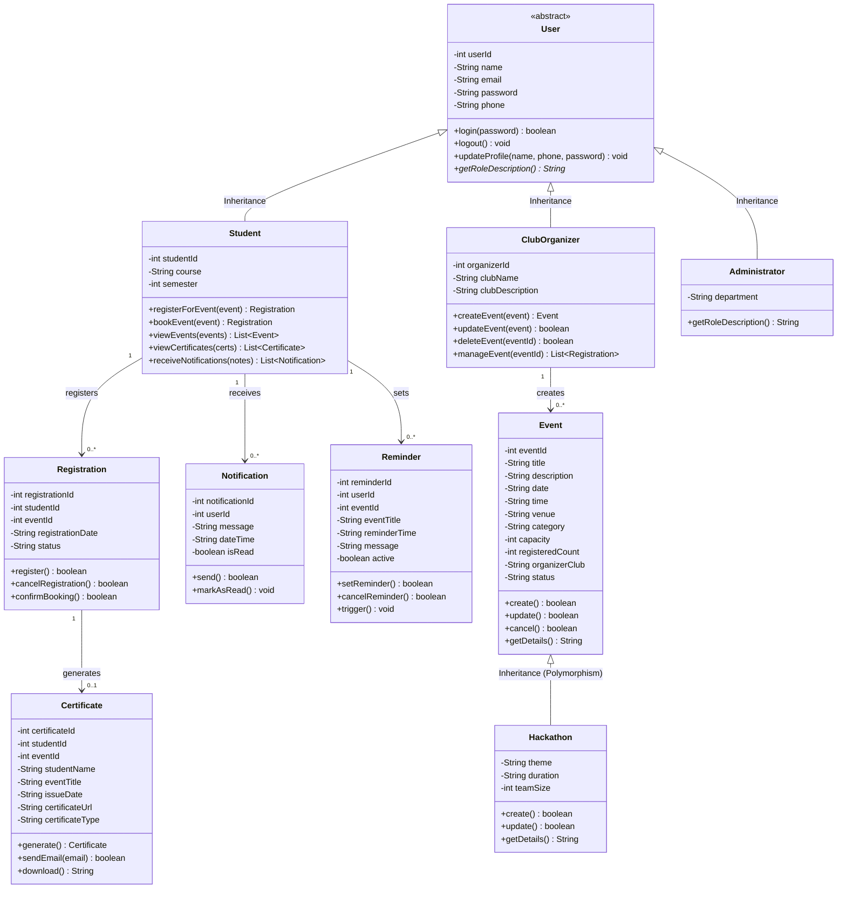

# EVENT SPECTRA — Centralized Event Management Platform for FISAT

> **"All events in a nutshell"**  
> *Discover • Register • Participate • Achieve*  
> **Course:** Object-Oriented Programming (OOPS) in Java  
> **Institution:** Federal Institute of Science and Technology (FISAT), Angamaly  

---

## 👥 Project Team

| Sl. No. | Student Name | Roll No. | Academic Role / Assigned Module |
|---|---|---|---|
| 1 | **Joanna Jomon** | 46 | UI/UX & Event Registration Module |
| 2 | **Joel Shantu** | 47 | Notification & Reminder Module |
| 3 | **Joseph P Subash** | 48 | Backend Architecture & Java OOP Modeling (Lead) |
| 4 | **Joshua Jomesh** | 49 | Certificate Generation & Verification Module |
| 5 | **Jovial J Thattil** | 50 | Event & Club Management Module |

---

## 📖 1. Introduction & Background
**Event Spectra** is a centralized, user-friendly event management application developed specifically for **FISAT** students. It serves as a single unified portal to discover and participate in various workshops, competitions, technical hackathons, and cultural activities organized by college clubs (e.g., FISAT ACM Student Chapter, IEEE SB FISAT, CSI, FOSS Cell).

### The Problem (Existing System)
- Event announcements are fragmented across noisy WhatsApp groups, social media stories, physical notice boards, and word of mouth.
- Students routinely miss important event updates and registration deadlines.
- Registrations and ticket collection are handled through disparate Google Forms without live capacity tracking.
- Certificates are distributed piecemeal via email links or external folders, making them difficult to track, retrieve, or authenticate for academic portfolios.

### The Proposed Solution
- **Centralized Platform:** All college events and hackathons consolidated in one place.
- **1-Click Booking:** Instant registration with real-time seat availability.
- **Automated Certificate Hub:** Accredited digital completion certificates accessible and downloadable directly from the dashboard.
- **Smart Reminders & Alerts:** Proactive notifications keep students updated before deadlines.

---

## 🏗️ 2. Core OOP Architecture & Class Diagram Implementation

The project is built on **pure Core Java** (Standard JDK) adhering strictly to the **UML Class Diagram** specified in the requirements:



### Key OOP Principles Demonstrated in Java Code:
1. **Abstraction:**
   - [`User.java`](file:///c:/Users/Joseph%20P%20Subash/OneDrive/Documents/oops%20project/src/User.java) is declared `abstract`. It captures fundamental attributes (`userId`, `name`, `email`, `phone`) and forces derived roles to implement `getRoleDescription()`.
2. **Inheritance:**
   - [`Student.java`](file:///c:/Users/Joseph%20P%20Subash/OneDrive/Documents/oops%20project/src/Student.java) and [`ClubOrganizer.java`](file:///c:/Users/Joseph%20P%20Subash/OneDrive/Documents/oops%20project/src/ClubOrganizer.java) extend `User`.
   - [`Hackathon.java`](file:///c:/Users/Joseph%20P%20Subash/OneDrive/Documents/oops%20project/src/Hackathon.java) extends [`Event.java`](file:///c:/Users/Joseph%20P%20Subash/OneDrive/Documents/oops%20project/src/Event.java), acquiring all event properties (`title`, `venue`, `capacity`) while introducing hackathon-specific fields (`theme`, `duration`, `teamSize`).
3. **Polymorphism (Dynamic Method Dispatch):**
   - The method `getDetails()` is declared in `Event` and overridden in `Hackathon`. Calling `e.getDetails()` dynamically invokes `Hackathon`'s version at runtime when `e` holds a `Hackathon` instance.
4. **Encapsulation:**
   - All variables across classes are declared `private` and accessed strictly through public getters, setters, and business methods.
5. **Association & Multiplicity:**
   - `Student` ↔ `Registration` (1 to 0..*)
   - `Registration` ↔ `Certificate` (1 to 0..1)
   - `ClubOrganizer` ↔ `Event` (1 to 0..*)

---

## 🧩 3. System Modules (Page 8 Description)

| Module | Description & Capabilities |
|---|---|
| **Student Management** | Manages student profiles (Roll No, Course, Semester), event participation history, and certificates. |
| **Event Discovery** | Allows students to explore Today's Events, Upcoming Workshops, Competitions, and Hackathons with live search and filter chips. |
| **Event Registration** | Enables 1-click registration, live capacity decrement/increment, and registration status management. |
| **Notification & Reminder** | Dispatches real-time broadcast alerts, event updates, and allows students to schedule customizable reminders. |
| **Certificate Management** | Issues authenticated digital certificates with FISAT crest and provides high-resolution PNG/PDF download and email simulation. |
| **Club Management** | Equips Club Coordinators (ACM, IEEE, CSI, FOSS) to publish new events, monitor registrations, and issue certificates. |
| **Admin Management** | Provides system-wide oversight: active student directory, club accounts, system audit log, and emergency broadcasts. |

---

## 🚀 4. How to Run the Project

### Option A: 1-Click Launch (Recommended)
Simply double-click:
```bash
run.bat
```
*(or in PowerShell: `powershell -ExecutionPolicy Bypass -File .\run.ps1`)*

This script automatically:
1. Detects your installed JDK/JBR.
2. Compiles all `.java` files from `src/` into `bin/`.
3. Starts the Java web server on port `8080`.
4. Opens `http://localhost:8080/` in your browser.

---

### Option B: Manual Command Line (Using Standard javac/java)
Open terminal in the project directory:

```bash
# 1. Compile Java files
javac -d bin src/*.java

# 2. Run the application
java -cp bin Main
```
Then visit: **[http://localhost:8080](http://localhost:8080)**

---

### Option C: Direct Browser Preview (Standalone)
If running on a machine without a Java compiler:
Simply double-click:
```
web/index.html
```
The website includes an intelligent fallback that executes the exact same OOP data models in the browser!

---

## 📂 5. Directory Structure

```
oops project/
├── README.md               # Complete Project Report & Academic Guide
├── run.bat                 # 1-Click Windows Batch Runner
├── run.ps1                 # 1-Click PowerShell Runner
├── bin/                    # Compiled Java .class Bytecode files
├── src/                    # Core Java Source Code (Clean Basics of Java)
│   ├── User.java           # Abstract Base Class
│   ├── Student.java        # Inherits User
│   ├── ClubOrganizer.java  # Inherits User
│   ├── Administrator.java  # Inherits User
│   ├── Event.java          # Base Event Class
│   ├── Hackathon.java      # Inherits Event (Polymorphic getDetails)
│   ├── Registration.java   # Association between Student and Event
│   ├── Certificate.java    # E-Certificate Generator
│   ├── Notification.java   # Notification alerts
│   ├── Reminder.java       # Scheduled Reminders
│   ├── DataStore.java      # In-Memory Database & Seed Data
│   ├── JsonHelper.java     # Pure Java JSON serializer (No 3rd party JARs)
│   ├── SimpleHttpServer.java# Built-in Java SE HTTP Server
│   └── Main.java           # Entry point with OOP demonstration
└── web/                    # Modern Responsive Web Frontend
    ├── index.html          # Main Web Application & Modals
    ├── style.css           # Premium FISAT Academic Theme
    └── app.js              # Client logic, REST client, Canvas Certificate
```

---

## 🎯 6. Key Features for Lab Viva / Presentation

1. **Role Switcher in Top Bar:**
   - Click the profile chip on the top-right to switch between:
     - **Joseph P Subash** (Roll 48 - Student)
     - **Joanna Jomon** (Roll 46 - Student)
     - **ACM / IEEE Club Coordinators** (Unlocks the Club Portal & event creation)
     - **FISAT Administrator** (Unlocks the Admin Oversight console)
2. **Polymorphic Event Creation:**
   - Switch to Club Coordinator -> Click "+ Create & Publish Event".
   - When selecting category **"Hackathon"**, specialized attributes (*Theme*, *Duration*, *Team Size*) automatically appear and instantiate a `Hackathon` object in Java.
3. **Live Certificate Generation & Download:**
   - Go to "Certificates" tab -> Click "View & Download" on any certificate.
   - Click **"Download Official Certificate"** to render a high-resolution canvas certificate with FISAT seal, signatures, and roll number.
4. **OOP Architecture Modal:**
   - Click the **"☕ Java OOP Architecture"** pill in the top header for an instant summary of how each concept is coded in Java.
